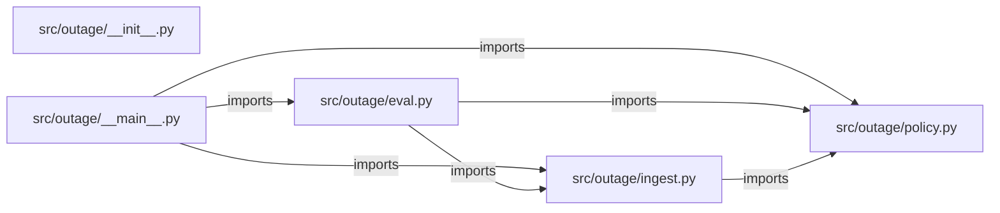

# fde-outage-desk — project architecture

[README](README.md) · [Interview questions and answers](INTERVIEW_QA.md)

## Purpose and scope

Simulated forward deployed engagement for Cedar Grid, a regional utility. The storm desk was sorting outages by customer count. A feeder with a registered life-safety account was waiting behind a larger commercial outage. The control room will not let this tool text customers or dispatch a crew by itself.

This document describes files and symbols in this checkout. Deployment templates and statements in the original overview are distinguished from a verified running environment.

## Component diagram



For Python repositories, arrows show resolved local imports, not network calls or deployment order. Otherwise the diagram is a repository component map; containment arrows do not assert runtime integration.

## Components and responsibilities

| Component | Responsibility |
| --- | --- |
| [`src/outage/eval.py`](src/outage/eval.py) | Functions: `run` |
| [`src/outage/policy.py`](src/outage/policy.py) | Functions: `life_safety_feeders`, `rank_outages`, `render` |
| [`src/outage/ingest.py`](src/outage/ingest.py) | Functions: `load_accounts`, `load_outages`, `load_cases` |
| [`requirements.txt`](requirements.txt) | Implementation or supporting configuration |
| [`src/outage/__init__.py`](src/outage/__init__.py) | Implementation or supporting configuration |
| [`src/outage/__main__.py`](src/outage/__main__.py) | Functions: `main` |
| [`Dockerfile`](Dockerfile) | Container build/service configuration |
| [`tests/test_policy.py`](tests/test_policy.py) | Executable checks and regression examples |
| [`.github/workflows/ci.yml`](.github/workflows/ci.yml) | GitHub Actions job definitions |
| [`README.md`](README.md) | Project explanations or operating notes |
| [`docs/01-discovery.md`](docs/01-discovery.md) | Project explanations or operating notes |
| [`docs/02-security.md`](docs/02-security.md) | Project explanations or operating notes |

## Existing design and operating guides

These checked-in guides provide the project’s detailed design, operational context, or deployment view:

- [`docs/01-discovery.md`](docs/01-discovery.md).
- [`docs/02-security.md`](docs/02-security.md).

## Implementation walkthrough

### `run(path: Path | None=None)`

Source: [`src/outage/eval.py`](src/outage/eval.py#L9).

Calls visible in this function: `failures.append`, `item.render`, `len`, `load_accounts`, `load_cases`, `load_outages`, `print`, `rank_outages`, `ranked.get`.

```python
def run(path: Path | None = None) -> int:
    ranked = {item.outage_id: item for item in rank_outages(load_outages(), load_accounts())}
    failures = []
    cases = load_cases(path)
    for case in cases:
        item = ranked.get(case["outage_id"])
        if case["expected"] == "excluded":
            if item is not None:
                failures.append(f"{case['outage_id']} was ranked")
            continue
        if item is None:
            failures.append(f"{case['outage_id']} missing")
            continue
        if item.score != case["expected_score"]:
            failures.append(f"{case['outage_id']}: score {item.score}")
        if "message customers" not in item.render():
            failures.append(f"{case['outage_id']}: missing customer-message refusal")
    order = [item.outage_id for item in rank_outages(load_outages(), load_accounts())]
    if order and order != ["OUT-1", "OUT-2"]:
        failures.append(f"order {order}")
    if failures:
        print(f"{len(failures)} eval failure(s)")
```

The excerpt is truncated; the linked source contains the full implementation.

### `rank_outages(outages: list[Outage], accounts: list[Account])`

Source: [`src/outage/policy.py`](src/outage/policy.py#L43).

Calls visible in this function: `Ranked`, `life_safety_feeders`, `min`, `ranked.append`, `ranked.sort`, `reasons.append`, `tuple`.

```python
def rank_outages(outages: list[Outage], accounts: list[Account]) -> list[Ranked]:
    protected = life_safety_feeders(accounts)
    ranked: list[Ranked] = []
    for outage in outages:
        if outage.status != "open":
            continue
        score = 0
        reasons: list[str] = []
        if outage.feeder in protected:
            score += 100
            reasons.append("Life-safety account on this feeder (+100)")
        customer_points = min(40, outage.customers_affected // 10)
        duration_points = min(30, outage.minutes_open // 10)
        score += customer_points + duration_points
        reasons.append(f"{outage.customers_affected} customers affected (+{customer_points})")
        reasons.append(f"Open {outage.minutes_open} minutes (+{duration_points})")
        crews = 2 if score >= 100 else 1
        ranked.append(Ranked(outage.outage_id, outage.feeder, score, crews, tuple(reasons)))
    ranked.sort(key=lambda item: item.score, reverse=True)
    return ranked
```

### `load_outages()`

Source: [`src/outage/ingest.py`](src/outage/ingest.py#L22).

Calls visible in this function: `(DATA_DIR / 'outages.csv').open`, `Outage`, `csv.DictReader`, `int`.

```python
def load_outages() -> list[Outage]:
    with (DATA_DIR / "outages.csv").open(newline="") as handle:
        return [
            Outage(
                row["outage_id"],
                row["feeder"],
                int(row["customers_affected"]),
                int(row["minutes_open"]),
                row["status"],
            )
            for row in csv.DictReader(handle)
        ]
```

### `render(self)`

Source: [`src/outage/policy.py`](src/outage/policy.py#L30).

Calls visible in this function: `'\n'.join`.

```python
    def render(self) -> str:
        reason_lines = "\n".join(f"- {reason}" for reason in self.reasons)
        return (
            f"Outage {self.outage_id} on {self.feeder} score {self.score}.\n"
            f"Suggest {self.crews} crew(s). This does not dispatch them and does not message customers.\n"
            f"{reason_lines}\n"
        )
```

## Validation and failure paths

| Explicit exception | Source |
| --- | --- |
| `SystemExit(main())` | [`src/outage/__main__.py`](src/outage/__main__.py#L19) |

These are explicit exceptions in the inspected source, rather than a claim that every failure is handled. Follow the calling handler to see whether the exception becomes an HTTP response or propagates.

## Data flow and design decisions

### What is the input-to-output contract of `run`

In [`src/outage/eval.py`](src/outage/eval.py#L9), `run(path: Path | None=None)` receives the inputs. The function computes these intermediate values:

- `ranked = {item.outage_id: item for item in rank_outages(load_outages(), load_accounts())}`
- `failures = []`
- `cases = load_cases(path)`
- `order = [item.outage_id for item in rank_outages(load_outages(), load_accounts())]`

Its result is defined by:

- `0`
- `1`

### Which decision rules or boundary conditions should an interviewer challenge

The implementation in [`src/outage/eval.py`](src/outage/eval.py#L9) branches on:

- `order and order != ['OUT-1', 'OUT-2']`
- `failures`
- `case['expected'] == 'excluded'`
- `item is None`
- `item.score != case['expected_score']`
- `'message customers' not in item.render()`
- `item is not None`

A useful extension is a table-driven test that covers each condition just below, at, and above its boundary where applicable. These expressions are the current rules; changing them changes behavior and should be justified by the project’s acceptance criteria.

## Setup and verification

The following commands are derived from the checked-in dependency/test contracts. Execute them from the repository root; the block prepares a local environment, not a cloud deployment.

```bash
python3 -m venv .venv
source .venv/bin/activate
python -m pip install -r requirements.txt
python -m pytest -q
```

Python dependencies: [`requirements.txt`](requirements.txt).

Test entry points: [`tests/test_policy.py`](tests/test_policy.py).

Automation definitions: [`.github/workflows/ci.yml`](.github/workflows/ci.yml). Read their triggers and job steps to determine what CI actually runs.

## Operating boundaries and design review

Before turning this checkout into a customer deployment, establish the input contract, data ownership, access controls, failure response, evaluation criteria, and rollback owner. Repository fixtures and unit tests demonstrate local behavior; they do not establish throughput, uptime, compliance, or business impact.

A useful architecture review starts with the linked implementation: identify where input enters, where a decision is made, which state can change, and which external dependency can fail. Add a deployment view only for infrastructure that is actually configured and exercised.
